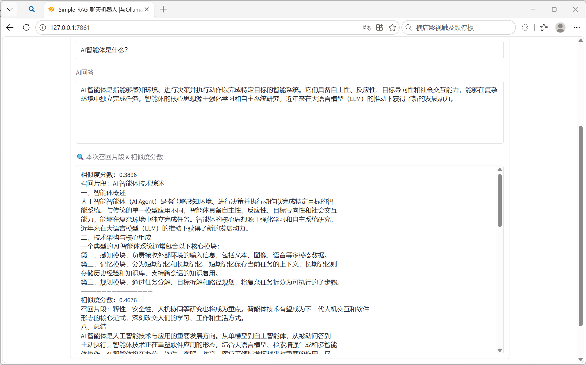

# Simple-RAG-chatbot
Lightweight local RAG document QA assistant built with Ollama, LangChain, Chroma and Gradio.
Supports offline PDF / TXT document question answering.

## Features
- Local offline inference, no third-party API needed
- Retrieve chunks with similarity score visualization
- Strict prompt rules to reduce LLM hallucination
- Support uploading PDF and TXT files

## Prepare
Pull required Ollama models first:
```bash
ollama pull qwen2.5:3b
ollama pull nomic-embed-text

Install dependencies：
pip install -r requirements.txt

Run project：
python main.py

Visit the web page at: http://127.0.0.1:7860

## Demo Screenshot


Adjustable parameters
CHUNK_SIZE: Length of each split text chunk
CHUNK_OVERLAP: Overlap between adjacent chunks
TOP_K: Number of documents retrieved
SIMILARITY_THRESHOLD: Filter out low-relevance text chunks